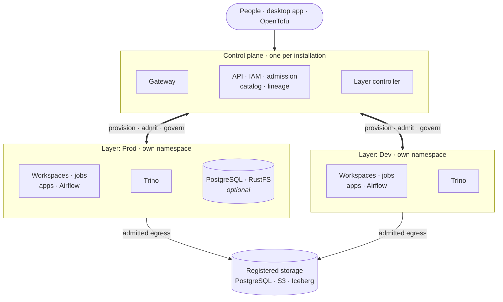
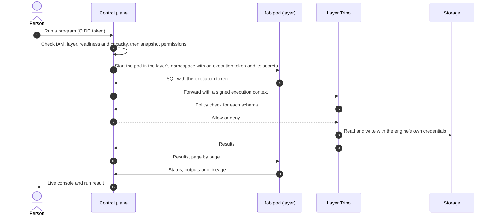

# Control plane and layers

FDP is split into one **control plane** and any number of isolated **layers**. The control plane
decides; the layers execute. Every workspace, job, app, dbt run and Airflow task runs inside a layer,
and nothing runs in a layer unless the control plane has admitted it.

## The difference

| | Control plane | Layer |
|---|---|---|
| How many | One per installation | As many as you define, for example Dev, Test and Prod |
| Runs | Gateway, API, IAM, admission, catalog, lineage, SLAs, GitOps, the layer controller and the package repository | Workspaces, jobs, apps, dbt, Airflow, its own Trino, and optionally its own PostgreSQL and RustFS |
| Holds | Platform metadata, policy and secret references | Workload pods, run artifacts and layer-local data |
| Talks to | Identity provider, secret store, metadata database | The control plane, and only the storage it has been admitted to |
| Kubernetes namespace | The release namespace | One per managed layer: `fdp-<installation>-layer-<id>` |
| Credentials | Signing keys, secret-store access, access-setup logins | Short-lived execution tokens; storage logins stay on the layer's Trino |
| Decides | Who may do what, and where it runs | Nothing: it executes what was admitted |

Layers are isolation boundaries, not projects or teams. One person can work in several layers, but
every execution is bound to exactly one, and its permissions are narrowed to that layer. See
[layers](../layers.md) for how objects are assigned to them.

## How they fit together

The control plane provisions each layer, admits and starts its pods, and serves their API and SQL
requests. There is no path between Prod and Dev. Only a layer's Trino may reach its databases and
Iceberg storage; code in the layer reaches Trino only through the control plane. The one direct path
from code to storage is plain S3 files, with short-lived credentials limited to the granted prefixes.

## How they interact

1. **Provisioning.** You declare a layer's infrastructure (in the app or with OpenTofu). The layer
   controller turns it into a namespace with default-deny network policies, a resource quota, a Trino
   cluster, volumes and optional PostgreSQL and RustFS, and reports when the layer is Ready.
2. **Admission and placement.** A request to start a workspace, run or deployment arrives at the
   control plane. It checks IAM, the layer, readiness and capacity, records a permission snapshot for
   jobs, and only then starts the pod in the layer's namespace with a short-lived execution token.
3. **Data access.** Code in the layer sends SQL to the control plane's SQL gateway with its execution
   token. The gateway forwards it to that layer's Trino with a signed execution context, and Trino asks
   the control plane for a policy decision on every schema it touches. For plain S3 files, the control
   plane issues short-lived credentials limited to the granted prefixes, and only pods granted that
   storage may reach its endpoint.
4. **Secrets and identity.** Only the control plane reaches the secret store. It injects the secrets a
   program is allowed to use when the pod starts. Layers never reach the secret store or the metadata
   database.
5. **Traffic.** People reach editors and apps only through the gateway. Layer pods may reach the
   control plane's API port, DNS, their own Trino and the storage egress you admit; workspaces can also
   use the egress allowlist proxy. Nothing else enters or leaves a layer.
6. **Feedback.** Runs report status, logs, outputs, lineage and quality observations back to the
   control plane. The control plane reads each layer's Trino load and the layer controller scales its
   workers.

## A program run, step by step

The job never sees a database password or a long-lived storage key, and it cannot reach Trino, a
database or another layer directly.

## Managed and unmanaged layers

Everything above describes **managed** layers. An unmanaged layer, without infrastructure, uses the same
control plane and authorization, but its pods run in the shared runtime namespace. It is an
authorization boundary only, without network isolation. Use managed layers wherever layers must be
separated, as with production and non-production.
