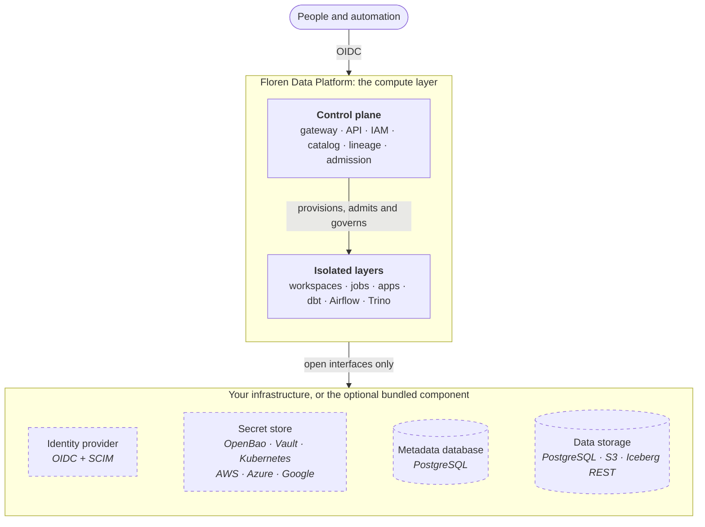

# Design principles

Floren Data Platform (FDP) is the **governed compute layer** of a data platform. It runs
workspaces, programs, dashboards, dbt and Airflow on Kubernetes. It decides who and what
may touch which data, and records what happened. It does not ask you to move your data
into it, adopt a particular cloud or buy a particular identity or secrets product.

Three principles shape every part of the design.

## 1. Security by design

Controls are part of every request path, not a layer added around the platform. Every
person and workload has an identity. Permissions are explicit and additive. Security
context is derived on the server, never trusted from a client. Credentials for databases
and storage never reach user code. Anything unknown is denied. See
[security by design](security.md).

## 2. Bring your own infrastructure

The identity provider, secret store, metadata database and data storage are **interfaces,
not products**. FDP talks to them through open standards:

| You bring | FDP uses |
|---|---|
| Identity provider | OpenID Connect for sign-in, SCIM 2.0 for the directory |
| Secret store | OpenBao or HashiCorp Vault (KV v2), Kubernetes Secrets, AWS Secrets Manager, Azure Key Vault or Google Secret Manager |
| Metadata database | PostgreSQL |
| Data storage | PostgreSQL, S3-compatible object storage, Iceberg REST catalogs |
| Source control | Git over HTTPS |
| Kubernetes | Any conformant cluster whose network plugin enforces NetworkPolicy |

Each one can be replaced independently. [Bring your own infrastructure](bring-your-own.md)
lists the exact requirements and what has been tested.

## 3. No vendor lock-in, portable by default

- **Open source throughout.** FDP is Apache-2.0 and uses only free, OSI-approved components.
  No feature depends on a commercial license or a hosted service.
- **Open data formats.** Data stays in PostgreSQL, Iceberg tables and plain files in your
  own buckets. FDP stores metadata about your data, not the data itself. Removing FDP
  leaves your data where it was, readable by any tool.
- **Any cloud, or none.** The platform needs Kubernetes, PostgreSQL and S3-compatible
  storage. It runs the same way on a public cloud, on-premises or air-gapped.
- **Configuration as code.** Installation is a Helm chart, and everything inside the
  platform can be declared with OpenTofu. An installation can be rebuilt elsewhere from
  its configuration, a metadata backup and its secrets.

## Batteries included, all optional

You can start with nothing but a Kubernetes cluster. For evaluation and smaller
installations, the Helm chart can run the supporting services for you:

| Need | Optional bundled component | Replace with |
|---|---|---|
| Identity provider | Keycloak | Any OIDC + SCIM provider |
| Metadata database | PostgreSQL | Your managed or self-hosted PostgreSQL |
| Secret store | OpenBao, auto-unsealed by a key in a Kubernetes Secret or by your KMS | Your OpenBao or Vault, Kubernetes Secrets, or your cloud's secret manager |
| Layer data storage | PostgreSQL and RustFS (S3-compatible) per managed layer | Your own databases and buckets |
| SQL engine | Trino per managed layer | Always part of FDP: it enforces data access |

Each bundled component can be switched off independently. Start fully bundled, then
point the platform at your own services as you grow. Applications and data products
do not change when you do. Bundled databases and RustFS are single-instance. Use your own
highly available services where you need high availability.

## What FDP is, and is not

| FDP is | FDP is not |
|---|---|
| Compute: workspaces, jobs, apps, dbt and Airflow on Kubernetes | A database or warehouse that holds your data |
| Governance: IAM, catalog, lineage, quality and SLAs | An identity provider or user directory |
| A governed SQL path into the storage you register | A secrets manager |
| GitOps publishing from your repositories | A hosted service or a cloud-specific product |

Each dashed service can be replaced independently. The split between the control plane and the layers
is described in [control plane and layers](control-plane-and-layers.md).

Continue with [system components](components.md) for the request and execution paths.
