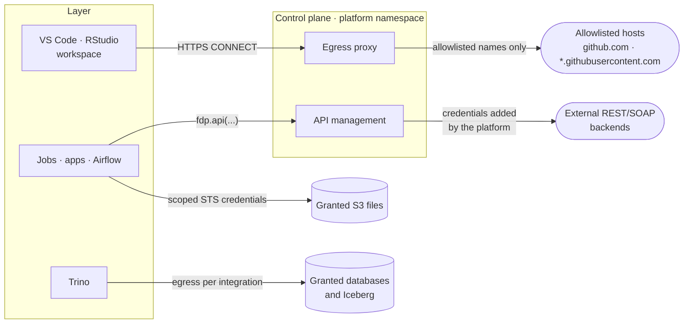
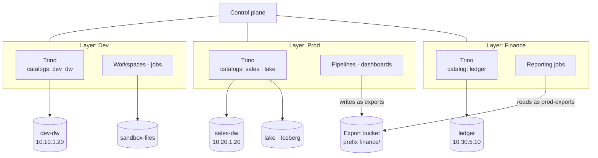

# Layer isolation

A layer is how FDP separates work that must not mix: development from production, one regulated domain
from the rest, one customer from another. A managed layer is not just a label. Several independent
controls enforce it, so a mistake in one does not open a path into another layer.

## What a managed layer gives you

| Boundary | What it achieves | Enforced by |
|---|---|---|
| Authorization | Every execution is bound to one layer; its permissions are narrowed to that layer's objects, even for administrators | The control plane, on every request |
| Separate SQL engine | Each layer has its own Trino with only its own catalogs. Another layer's database is not just forbidden: the engine does not know it | The layer controller |
| Network segregation | Default-deny traffic; only documented paths are open, and data egress only to the networks granted per integration | NetworkPolicy, enforced by your CNI |
| Credentials | Storage logins exist only in that layer's Trino catalogs; production layers refuse personal and group secrets; workload identities belong to one layer | The control plane and the layer controller |
| Compute budget | A ResourceQuota and default container limits per layer, so one layer cannot starve another | Kubernetes |
| Pod security | Pod Security admission on each layer namespace (`baseline` enforced, `restricted` audited and warned) | Kubernetes |
| Storage | Separate workspace and artifact volumes, retained when a layer is retired | Kubernetes, storage class |

Unmanaged layers only have the authorization boundary. Use managed layers wherever separation
matters.

## Network segregation and your CNI

Each managed layer namespace starts with a policy that denies all ingress and egress. The layer
controller then opens only these paths:

| From | To | Why |
|---|---|---|
| Every layer pod | Cluster DNS | Name resolution |
| Every layer pod | Control plane API port | API, SQL, file credentials, run reporting |
| Gateway and control plane | Editors and apps | People open them through the gateway only |
| Control plane | The layer's Trino coordinator | Forwarded SQL with a signed execution context |
| Trino pods | Each other | Query exchange inside the layer |
| Trino pods | Granted PostgreSQL and Iceberg networks | Per integration, on its ports only |
| Pods granted an S3 files integration | That integration's S3 endpoint | Per integration, on its port only |
| VS Code and RStudio workspaces | The egress proxy | Internet access to allowlisted host names |
| Airflow components | Their own deployment's broker and database | Distributed Airflow only |

Grants are **IP ranges you configure** (`egress` on each integration), never addresses discovered
through DNS. The controller subtracts the cluster's pod, service and node ranges, any protected ranges
and reserved addresses such as the cloud metadata service. A broad grant like `10.0.0.0/8` therefore
cannot open a path into another layer or the control plane's internals. Until the cluster ranges are set
(`layerController.network`), data egress is refused rather than guessed.

These are standard Kubernetes NetworkPolicies. **Your CNI enforces them, and a CNI that ignores
NetworkPolicy silently removes the network boundary.** Use a CNI that enforces NetworkPolicy, for example
Cilium, Calico, Antrea or k3s's built-in controller. On managed Kubernetes, enable the provider's network
policy support (for example the EKS network policy agent, AKS network policy or GKE Dataplane V2).
Plain Flannel does not enforce policies.

`make preflight` proves enforcement before you install: it creates a temporary namespace and checks that
a deny policy actually blocks traffic. The automated installation test runs on k3s; Cilium is also
verified manually. IPv6 is not supported yet. For managed databases whose addresses change, use private
endpoints with stable addresses so the grants stay narrow.

## Outbound paths: data, the workspace allowlist and APIs

Editor HTTPS access now requires both a platform host ceiling and an explicit host list for its
own layer. New CONNECT requests use a signed active-workspace ticket and recheck both lists.
Dev policy management cannot modify another layer or the platform ceiling. Configure and migrate
these grants as described in [scoped permissions](../scoped-permissions.md#network-migration-and-operations).

Three separate mechanisms control traffic leaving a layer. They do not overlap:



| Mechanism | Who uses it | What it allows | Configured with |
|---|---|---|---|
| Data egress | The layer's Trino; pods granted an S3 files integration | That integration's IP ranges and ports | `egress` on each storage integration |
| Workspace allowlist | VS Code and RStudio workspaces only | HTTPS to listed host names through the egress proxy, never to private addresses | `fdp_egress_allowlist`, `egressProxy.enabled` |
| API management | Programs calling an external API, outside callers of an internal API | Declared operations of registered APIs, under API permissions | `fdp_api`, `fdp_api_operation` |

**How the allowlist relates to API management.** The allowlist gives *developers* internet access from
their editors, for example to Git hosts. It does not apply to jobs or apps, which have no direct internet
access at all. When a program needs an outside service, register it as an **external API**: the program
calls `fdp.api("crm")`, and the control plane makes the call with the configured credentials. The
backend therefore needs neither an allowlist entry nor layer egress. What decides access is the
program's Consumer permission on the API, in the same layer. The credentials never reach the program,
and every call is audited. Only the control plane's own network needs to reach the backend.

**Internal APIs** go the other way: outside callers reach the API gateway, authenticate with JWT or
mTLS, and the control plane runs the target program in its layer as the API's own identity. No egress
rule is involved.

Only administrators register APIs, and the control plane can reach whatever its own network allows. To
limit which backends can be registered in practice, restrict the control plane's egress with your own
network policy or firewall.

## Worked example: three layers, different data

An organisation separates development, production and a regulated finance domain:

| Layer | Purpose | Storage integrations | Granted networks |
|---|---|---|---|
| **Dev** | Development; workspaces allowed | `dev-dw` (PostgreSQL), `sandbox-files` (S3 files) | `10.10.1.20/32`, `10.10.2.0/28` |
| **Prod** | Production pipelines and dashboards; no workspaces | `sales-dw` (PostgreSQL), `lake` (Iceberg), `exports` (S3 files) | `10.20.1.20/32`, `10.20.3.0/24` |
| **Finance** | Regulated ledger; production | `ledger` (PostgreSQL), `prod-exports` (S3 files) | `10.30.5.10/32`, `10.20.3.0/24` |



No line crosses from one layer's engine to another layer's storage: Dev's Trino has neither a catalog
nor a network route for `sales-dw`, and Prod's has neither for `ledger`. The only shared object is the
export bucket, registered separately in each layer.

Declared with OpenTofu (credentials omitted):

```hcl
resource "fdp_layer" "dev" {
  name           = "Dev"
  workspaces     = true
  infrastructure = jsonencode(local.isolated)
}
resource "fdp_layer" "prod" {
  name           = "Prod"
  production     = true
  workspaces     = false
  infrastructure = jsonencode(local.isolated)
}
resource "fdp_layer" "finance" {
  name           = "Finance"
  production     = true
  infrastructure = jsonencode(local.isolated)
}

resource "fdp_data_source" "dev_dw" {
  name     = "dev-dw"
  kind     = "postgres"
  layer_id = fdp_layer.dev.id
  config   = jsonencode({ host = "10.10.1.20", port = 5432, database = "sales", catalog = "dev_dw" })
  egress   = ["10.10.1.20/32"]
}
resource "fdp_data_source" "sales_dw" {
  name     = "sales-dw"
  kind     = "postgres"
  layer_id = fdp_layer.prod.id
  config   = jsonencode({ host = "10.20.1.20", port = 5432, database = "sales", catalog = "sales" })
  egress   = ["10.20.1.20/32"]
}
resource "fdp_data_source" "lake" {
  name     = "lake"
  kind     = "iceberg"
  layer_id = fdp_layer.prod.id
  config = jsonencode({ catalog = "lake", warehouse = "s3://prod-lake/",
    catalog_uri = "https://iceberg.prod.internal", endpoint_url = "https://s3.prod.internal" })
  egress = ["10.20.3.0/24"]
}
resource "fdp_data_source" "exports" {   # Prod writes the hand-over files
  name     = "exports"
  kind     = "s3"
  layer_id = fdp_layer.prod.id
  config = jsonencode({ bucket = "handover", prefix = "finance", endpoint_url = "https://s3.prod.internal",
    role_arn = "arn:aws:iam::123456789012:role/fdp-handover" })
  egress = ["10.20.3.0/24"]
}
resource "fdp_data_source" "prod_exports" {   # Finance reads them
  name     = "prod-exports"
  kind     = "s3"
  layer_id = fdp_layer.finance.id
  config = jsonencode({ bucket = "handover", prefix = "finance", endpoint_url = "https://s3.prod.internal",
    role_arn = "arn:aws:iam::123456789012:role/fdp-handover" })
  egress = ["10.20.3.0/24"]
}
resource "fdp_data_source" "ledger" {
  name     = "ledger"
  kind     = "postgres"
  layer_id = fdp_layer.finance.id
  config   = jsonencode({ host = "10.30.5.10", port = 5432, database = "ledger", catalog = "ledger" })
  egress   = ["10.30.5.10/32"]
}
```

`sandbox-files` follows the same pattern as `exports`. Grants go on the schemas of each integration as
usual, for example Contributor for the Prod pipeline identity on `exports`, Reader for the Finance
reporting identity on `prod-exports`.

### What happens

| Situation | Result |
|---|---|
| A Prod pipeline joins `sales.public.orders` with `lake.analytics.events` | Works: both catalogs are in Prod's Trino, and the identity holds the schema grants |
| The same SQL from a Dev workspace | Refused: Dev's Trino has no `sales` or `lake` catalog, and Dev has no route to 10.20.1.20 |
| An engineer with Reader on both `dev-dw` and `sales-dw` | Can browse and preview `sales-dw` in the app with that grant, but code in a Dev workspace or Dev job cannot reach it. Prod allows no workspaces, so production code runs only as reviewed, deployed Prod workloads |
| A Prod job queries `ledger.public.entries` | Refused three times over: no catalog in Prod's Trino, no network route to 10.30.5.10, no grant |
| Finance reporting needs monthly sales totals | A Prod pipeline writes them to the hand-over prefix through `exports`; Finance reads them through `prod-exports`. Each side is governed, audited and visible in lineage in its own layer |
| A Finance job uses a personal API key | Refused: Finance is a production layer, so only service-account secrets are usable |
| A Dev workspace runs `pip install` | Goes through the platform package repository; `git clone` from GitHub works only if `github.com` is on the allowlist |

Each catalog name is unique across the installation, so a query always names exactly one integration in
exactly one layer. Data moves between layers only through a deliberate, governed hand-over like the one
above, never through a shared engine or network path.
