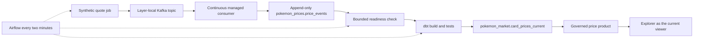

# Pokémon platform demo: streaming, products and access

The Pokémon example combines managed APIs, immutable S3 landing files, append-only
raw tables, dbt history and quality tests, Airflow, Kafka, data products, caller-bound
Streamlit dashboards, classification, masking and reviewed access. The optional
price pipeline uses **synthetic EUR quotes**, clearly labelled `synthetic_demo`.
They are not live market prices or financial valuations.

The reusable code is in [examples/pokemon](../examples/pokemon); the Terraform
module is in [terraform/modules/pokemon](../terraform/modules/pokemon). Copy the
application files to your workload repository, with `fdp.json` at its root. Local
edits do not change deployed workloads until the corresponding branch is pushed.
The installation configuration uses separate platform and Pokémon Terraform states.

## Price flow

Each environment has its own topic `pokemon-card-prices-test` or
`pokemon-card-prices-prod`, service identities and tables. Three partitions retain
messages for seven days. Kafka retention does **not** delete SQL history. Define
retention for `price_events` separately before using this for sustained ingestion.
No personal data is emitted: the contract allows only three known cards, integer
EUR cents, timestamps, environment, identifiers and the synthetic-source label.

The publisher takes `run_id` and a logical UTC `observed_at`; retries must reuse
both. Event IDs and amounts are deterministic per environment/run/card. The sink
validates the entire poll before its first SQL write and commits offsets only after
all bounded inserts succeed. An invalid message stops processing without committing;
inspect and correct it using the operator process before restarting. There is no
silent poison-message skip or automatic dead-letter routing.

Delivery is **at least once**. A lost SQL response or Kafka commit can leave duplicate
raw rows. The materialized product deduplicates Kafka topic/partition/offset and then
selects one latest event per card. It retains event and Kafka provenance. A consumer
rebalance or restart may replay records; this is not a distributed exactly-once
transaction. The readiness job checks up to 30 times, with two-second intervals plus SQL latency,
for all three event IDs from the current producer run before dbt starts. A stopped sink fails the DAG
instead of publishing a successful result from stale input.

## Human access matrix

These are the installation's intended grants after applying the updated Terraform.
`—` means no grant from this configuration. Other direct, inherited or external
grants must be audited separately. Names such as Reader, Consumer and Maintainer
below are existing **object roles**. Viewer/Manager on named page/action namespaces
are the newer permission model; they do not replace object roles.

| Group | Visible pages | Non-Prod objects/actions | Prod objects/actions | Deliberately withheld |
|---|---|---|---|---|
| Data engineers | Home, Catalog, Products, Workspaces, Workloads, Runs, Storage, Kafka, APIs, Repositories, Packages | Lake Admin; Pokémon folder Admin; landing/raw/history Admin; API Admin; package browse | Standard product only if separately assigned | Prod lake/folder, global workload administration, network policy administration |
| Analysts | Home, Products, Requests, Catalog, Workspaces, Storage, Packages | Standard cards and price product Consumer; own analysis workspace | Standard cards and optional price product Consumer | Raw/history, producer/consumer identities, topic IAM, deployment |
| Viewers | Home, Products, Requests | Standard products and caller-bound explorer | Standard products and caller-bound explorer | SQL page, workspaces, Kafka, pipelines, administration |
| Pokémon release managers | Home, Repositories, Workloads, Runs | — | Pokémon folder Contributor and allowed repository group | Direct lake/raw/schema and API administration; global workloads Admin |
| Pokémon data owners | Home, Products, Reviews, Cases | Cards and price product Owner | Cards and optional price product Owner | Layer/network administration, unrelated products, workload deployment |
| Pokémon stream operators | Home, Kafka, Workloads, Runs | Price topic Admin; selected price jobs and price monitor Executor | Same, only when Prod Kafka is enabled | Bootstrap/DDL, other topics, raw SQL access, deployment edits, privacy review |
| Privacy office | Home, Reviews, Cases, Deadlines | — | Compliance reviewer for confidential/restricted data | Compliance Admin, forms/policies/classifications administration, storage, workloads, network policy changes |
| Access administrators | Home, Membership approvals | Membership approval duty for Analysts/Viewers only | Same groups, subject to the case | Data consumption, deployment, other groups' membership approvals |
| Package publishers | Home, Packages, Imports | Package repository Publisher; own newly published packages | Shared package repository | Allowlist administration, blanket Maintainer on all packages, data/workload access |
| Pokémon development network operators | Home, Network policies | `network.editor_allowlist` Manager on Non-Prod | — | Global ceiling changes, Prod allowlist, data/workload access |
| Global Admin | All administrative pages | Installation administration | Installation administration | Use only for setup and explicit administrator demonstrations |

All listed navigation pages receive explicit `pages` Viewer grants. App profiles
also restrict feature APIs. A page grant does not grant data or execution access;
object grants do not automatically reveal a page. Network Manager here can apply
or delete allowed layer entries beneath the global ceiling; only the installation
administrator can expand that ceiling. Prod editor internet access is empty by
default; Non-Prod explicitly receives the configured Git hosts.

**Production deployment is privileged:** a release manager who can change code
running as a fixed identity can cause that identity to read its authorised data.
Withholding interactive SQL is not a boundary against a malicious deployer. Protect
`main`, review changes and restrict release-group membership accordingly. Workload
execution and log access can expose output; do not put personal records or tokens
in logs. A stream Executor can inspect the deployment and its logs; the runtime
does not run continuous consumers as batch jobs. Starting, stopping or redeploying
the sink still needs deployment authority. Use the release/admin persona for that
outage rehearsal, rather than granting stream operators code-edit authority.

The process monitor runs with its own limited raw/history reader identity
and is restricted to engineers/release managers only. Stream operators instead get a separate price-only monitor.

The privacy duty covers Prod confidential/restricted data; the existing Non-Prod
restricted-data policy needs an explicitly assigned Non-Prod reviewer before such
requests can complete. The default does not silently give privacy staff every layer.
The privacy persona does not receive the global Access register page: the remaining
register scope migration is tracked in the platform permission matrix.

## Workload and storage matrix

Each row applies independently in Test and, when enabled, Prod. There is no
cross-layer service grant.

| Object / functionality | Managed actor | Exact object grants | Human authority |
|---|---|---|---|
| TCGdex registered external API | `extract` | API Consumer, declared GET operations only | Test engineers Admin; Prod managed by installation operator |
| RustFS landing files and manifests | `extract`, `load` | Extract landing Contributor; load landing Reader | Test engineers Admin; no analyst/viewer grants |
| `pokemon_raw` DDL | `bootstrap` | Raw schema Admin | Test engineers / trusted Prod release managers execute bootstrap |
| `pokemon_raw` insertion | `load`, `process-event` | Raw Contributor | Execute through the corresponding pipeline |
| SCD2 and card marts | `models` | Raw Reader, history Admin, reporting Admin | Test engineers; trusted Prod releases |
| `reporting.cards_current`, `set_summary` | Card data product | Standard Consumer with illustrator mask; optional row/price policies in Test | Analysts and viewers; product Owners govern options |
| Explorer dashboard | Current viewer | **No fixed reporting Reader grant**; delegated SQL uses viewer token on every query | Product consumers; no shared cross-viewer query cache |
| Process monitor | `monitor` | Raw/history Reader | Test engineers / trusted Prod releases only |
| Price operations monitor | `price-monitor` | `pokemon_prices` Reader, synthetic events only | Explicit stream operator Executor; no personal raw/history access |
| Price schema/table setup | `price-bootstrap` | `pokemon_prices` and `pokemon_market` Admin | Engineers in Test / trusted Prod releases; not stream operators |
| Kafka quote publication | `price-publish` | Own price topic Contributor | Engineers/releases and explicit stream operators Executor |
| Continuous Kafka ingestion | `price-sink` | Own topic Reader, append-only `pokemon_prices` Contributor | Engineers/releases and explicit stream operators Executor |
| Wait for this batch to land | `price-await` | `pokemon_prices` Reader | Pipeline identity Executor; no raw access passed to the orchestrator |
| Materialize current prices | `price-models` | `pokemon_prices` Reader, `pokemon_market` Admin | Engineers/releases and explicit stream operators Executor |
| `pokemon_market.card_prices_current` | Price data product | Separate schema, Consumer access; no personal card schema implied | Analysts/viewers Consumer; data owners Owner |
| Orchestration | `pipelines` | Executor only on its ingestion, models, result and enabled executable price steps | Test engineers / trusted Prod releases |
| Price quality | dbt and market-schema metric | Unique/non-null cards/events, EUR and synthetic label checks; minimum three quoted cards | Installation operator defines schema metric; authorised consumers inspect/measure |
| Price-model service level | SLA evaluator | 99% job success over 24 hours | Trusted workload owners; Unknown until evidence exists |
| Workspace development | Individual workspace identity | User's existing scoped grants | Engineering template Non-Prod; analysis template Non-Prod |
| Packages | Platform package repository | Separate Publisher group; engineer/analyst browse | Publisher may import approved packages; allowlist remains an administrator task |
| Reviewed personal-data access | Access case + product option | Prod confidential policy, owner then privacy review, expiry/renewal | Requester supplies form; distinct reviewers decide |

Card models live in `dbt/pokemon`; price models live in `dbt/prices`. Even a manual
build without a selector stays inside the corresponding project and identity scope.

The price builder's Admin scope is a separate market schema so it cannot alter the
personal card product. Schema roles remain broader than a single table: the sink
can append within `pokemon_prices`, and the builder can manage `pokemon_market`.
The six-role, per-function migration remains incomplete; see the full
[permission matrix](permission-matrix.md) and [scoped permissions](scoped-permissions.md).
This example does not establish that every platform action has least-privilege
enforcement. In particular, do not describe product object membership as a universal
per-table SQL boundary while the legacy schema grants remain in use.

## Prepare the installation

1. Deploy matching control-plane/UI/provider code containing named permissions and
   layer allowlists. Released provider 0.5.0 alone does not contain the new permission
   resources. Use a verified build of the current provider, or a release containing
   it; the example validator uses an isolated local build only for validation.
2. Assign **separate directory accounts** to demo groups. Group switching is useful,
   but another direct or inherited grant may still apply; Global Admin is unsuitable
   for proving that an ordinary user is denied.
3. Apply shared platform configuration first. Keep Non-Prod's existing managed Kafka
   registration: the local installation declares its import rather than creating a
   second cluster. Fresh installations must remove that installation-specific import
   and create their own registration.
4. Optionally enable Prod Kafka. Use an authorizer-enabled FDP Kafka image pinned to
   the deployment's reviewed image revision; never substitute a stock Kafka image.
   Prod defaults to three replicas. Non-Prod's existing single broker is a lab setup
   without broker-failure resilience. Check quotas, disk capacity, Strimzi and the
   layer certificate issuer before enabling it.
5. Keep `price_sink_environments = []` for the first Pokémon apply. Commit/promote
   application code to `test` and protected `main` before deploying their new programs.
   The local configuration vendors this module so all changes can be reviewed before
   a public module revision exists; replace it with an immutable published revision
   when releasing. Do not reapply the retired combined Terraform root.
6. Run `pokemon-bootstrap-test` and `pokemon-price-bootstrap-test` once. Repeat in
   Prod only if its price pipeline is enabled and promotion is approved.
7. Add `test` (and later `prod`) to `price_sink_environments`, review the new plan,
   then apply. Verify the continuous sink is healthy before scheduling the price DAG.
   Enabling this before bootstrap can cause a stream restart loop on missing tables.
8. Run the existing daily pipeline, then trigger `pokemon_test_prices` in Airflow.
   Its tasks publish three quotes, wait for durable SQL rows and run `dbt build
   --select tag:prices`. Keep production scheduling paused until rehearsed.

The reusable module uses `streaming_enabled`, `kafka_cluster_id`,
`price_sink_enabled`, `topic_replication_factor`, `product_owner_group_id`,
`stream_operator_group_id`, `stream_operators_enabled`, `engineering_data_access`
and `engineering_folder_role` to express the same configuration. The deployment
output `prices` reports the topic, bootstrap, publisher, builder, price monitor, sink and table names.
Creating Terraform resources does not execute bootstrap or generate data.

## Rehearse a 15-minute demo

| Time | Persona | Show | Check the denial as well |
|---|---|---|---|
| 0–2 min | Viewer | Only product navigation; open masked card explorer and labelled synthetic prices | Storage, Kafka and Workloads navigation absent |
| 2–5 min | Test engineer | Managed TCGdex operation, immutable manifest, raw record provenance, dbt SCD2 and lineage | No Prod folder deployment or Prod lake access |
| 5–8 min | Stream operator | Own topic, partitions/retention, producer job, consumer health; trigger a new quote run | Cannot edit workload code, execute bootstrap or manage unrelated topics |
| 8–10 min | Analyst | Current-price table, Kafka offset/event columns, dbt tests and quality metric | No raw-stream schema or topic access |
| 10–12 min | Data owner then privacy reviewer | Request *With illustrators* in Prod; form, owner decision, privacy decision and expiry | Privacy account cannot open workload/data/network administration |
| 12–14 min | Development network operator | Change Non-Prod Git allowlist within ceiling; show Prod has no grant | Prod edit and global ceiling expansion return 403 |
| 14–15 min | Operator/Admin | Run history and SLA evidence; discuss retries, data retention and Git promotion | Stop the sink: the next price DAG should time out rather than report a fresh publication |

The quality metric on the `pokemon_market` schema is a saved definition: measure it through the catalog using an
account authorised to read the product. An SLA may initially be Unknown; collect
real executions before showing success-rate evidence. There is no external webhook
configured by default. Existing platform alert channels can use scoped rules for
`run.failed`, `sla.breached` and `sla.recovered`; do not send messages to a real
recipient as part of a rehearsal without approval.

For verification, run `PYTHONPATH=sdk/python services/control-plane/.venv/bin/python
-m pytest examples/pokemon/tests -q` and `python3 examples/pokemon/validate.py` from
the platform source checkout. The optional `--installation` also validates isolated
copies of the two local `data-platform` roots and their vendored module. Neither
command reads live state, plans against the server or applies changes. Validate
actual allow/deny behavior with separate accounts after deployment, including
attempts through direct API calls rather than only hidden navigation.
