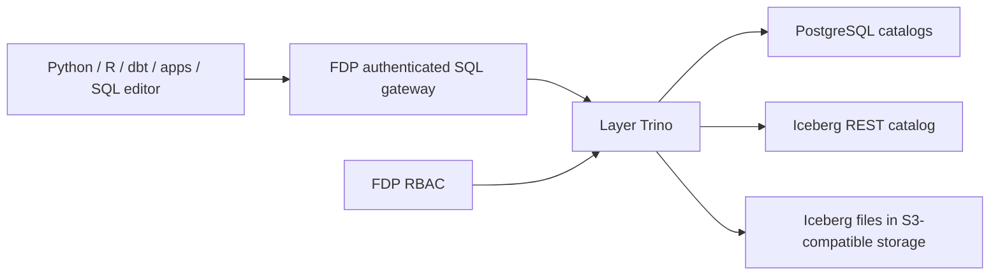

# SQL execution

All SQL in FDP, from Python, R, dbt, dashboards and the SQL editor, runs through one
governed path: an authenticated SQL gateway in front of [Trino](https://trino.io). Trino
queries the PostgreSQL databases and Iceberg tables you register as
[storage integrations](storage-integrations.md), and checks FDP's policy for every
object a query touches.

PostgreSQL suits small, fast queries and transactional sources. Iceberg suits lake-scale
storage and analytics. Both are reached through the same SQL interface. This does not
imply automatic data migration between them or identical SQL capabilities.

## Topology

Each managed [layer](layers.md) runs its own Trino coordinator and workers, scaled with
load. Unmanaged layers share the installation's Trino. Python and R compute pools run
code and submit SQL to that engine.
PostgreSQL still executes the work that Trino pushes down to it.

Each PostgreSQL database becomes a Trino catalog, and Iceberg gets a separate catalog.
Object names follow `catalog.schema.table`, for example `finance.reporting.revenue`
and `lake.analytics.events`. Queries can join across catalogs without first copying
PostgreSQL tables into Iceberg.

## Authorization and credentials

Data permissions are FDP's fixed schema roles, assigned to app groups and service
identities (see [RBAC](rbac.md)). Schema assignments cover current and future objects.
Trino enforces them on every referenced schema, including cross-catalog queries and
the source and target of writes. Discovery hides objects outside the effective grants.
Trino consults FDP through its OPA-compatible access-control plugin, which calls signed
endpoints in the control plane directly. No separate OPA service is needed, and FDP
remains the only place where permissions are assigned.

The gateway authenticates the actual user or workload. A client-supplied Trino username,
run ID, group list or execution-mode header is never trusted. The gateway forwards a
verified identity and a signed execution context bound to a durable query admission.

Caller-mode shared apps resolve the signed viewer on each SQL request and use live
permissions. Fixed-mode workloads use their managed identity or an authorized service
account. Admitted jobs keep their recorded permission snapshot until they finish. New
jobs, retries and scheduled invocations require fresh admission.

Database credentials, Iceberg catalog credentials and object-store keys stay on the
engine's catalogs. Workloads have neither those credentials nor a network route that
bypasses Trino. Give the PostgreSQL engine login authority only over managed schemas,
never superuser or role-administration privileges.

These operations are denied:

- native SQL pass-through and catalog/table procedures;
- Iceberg table registration, custom locations and unreviewed table properties;
- authorization statements and definer views. Views must explicitly specify
  `SECURITY INVOKER`, including inside `PREPARE` or `EXECUTE IMMEDIATE`;
- PostgreSQL native views and foreign tables, whose hidden dependencies Trino cannot
  check. Use invoker views in Iceberg, or materialized tables.

The `system.metadata` tables that dbt needs receive mandatory schema row filters.
Runtime configuration and query-inspection tables are unavailable. Unknown operations
fail closed.

Plain files use a separate API with scoped S3 credentials, on storage paths distinct from
Iceberg data. See [Iceberg and files](data-lake.md).

## SQL behavior

Python, R, dbt and delegated app queries use the same endpoint and Trino dialect. Use
dbt-trino for both PostgreSQL and Iceberg targets. Audit records include the effective
identity, initiating identity, run or workload ID and Trino query ID.

Roles express authorization, not connector capabilities. Trino's PostgreSQL connector
supports reads, writes and schema/table operations, but restricts UPDATE assignments and
DELETE predicates and does not expose every native PostgreSQL feature. FDP does not offer
PostgreSQL wire compatibility or multi-statement transactions: the gateway uses
autocommit. Unsupported operations return a clear capability error. They never fall back
to native credentials or unrestricted pass-through.

## Small-query performance

For PostgreSQL, Trino can push filters, projections, aggregations, limits and joins into
the database, which can then use its indexes. An indexed lookup need not become a full
scan. Verify pushdown for representative queries with `EXPLAIN` rather than assuming it.

Pushdown does not remove the gateway's and Trino's planning, scheduling and result
delivery overhead. A tiny indexed lookup is slower through Trino than through a direct
database connection. Benchmark p50/p95 latency and throughput for your own queries and
concurrency before committing to an application latency target. Start with a warm
engine, appropriate PostgreSQL indexes and validated pushdown.

## Configuring engine catalogs

1. Configure each catalog on the layer's Trino. In a managed layer, the platform writes
   the catalog from the integration's engine login. Otherwise, add it to
   `trino.catalogSecret` (one `<name>.properties` entry per catalog). Register each
   physical database or schema only once: duplicate catalog mappings are rejected.
2. PostgreSQL needs an engine login matching the catalog connection, plus a separate
   access-setup login. Access setup reconciles ownership and PUBLIC privileges and gives
   the non-superuser engine login DDL authority over managed schemas. Workloads receive
   neither credential.
3. Iceberg registration reserves the namespace in policy. An authorized Admin or Owner
   then creates it through SQL. Reserved table buckets (`FDP_SQL_LAKE_BUCKETS`, default
   `lake`) cannot be used for plain files.
4. `FDP_TRINO_SIGNING_KEY` must match Trino's gateway HMAC key. It is separate from the
   control plane's session key. Only the gateway mints coordinator tokens. Do not log
   policy request bodies or continuation tokens.

Use a network plugin that enforces NetworkPolicy, and restrict external database and
storage firewalls to the engine. Configure TLS to backends where the network requires it.
See the [layer infrastructure reference](layer-infrastructure.md) for managed-layer Trino
settings.

## Clients

Python `fdp.connect()` returns a Trino SQLAlchemy engine. R `fdp::connect()` returns a DBI
connection with paginated fetching and cancellation. Both renew job tokens while the job
is active. `query(source, sql, parameters=[...])` uses positional `?` parameters, for
workload calls or with `viewer_token=` for a viewer. Interactive query helpers return at
most 10,000 rows and time out after 30 seconds. Standard connections stream pages for the
engine's configured query lifetime. dbt profiles use dbt-trino with API authentication,
certificate validation and the selected catalog. They contain workload API tokens, never
database or object-store keys. The gateway accepts a correctly signed, expired job token
while that exact job remains active, so long dbt runs complete without extending editor
or workload tokens.

The protocol is `/v1/statement` plus signed `/v1/sql/pages/...` continuations. Status is
available at the response's `infoUri`, and deleting a continuation cancels the request.
Pages are bound to the submitting principal, workload and viewer. Audit stores the
identities and engine query ID, without SQL text or values. R keeps bigint and decimal
columns as strings and complex values as list columns. Convert them explicitly when an
analysis can accept numeric rounding.

Custom roles, individual object grants and a native low-latency bypass are not part of
the permission model. Infrastructure administrators acting directly on databases or
storage are outside FDP's application IAM.

## References

- [Trino PostgreSQL connector](https://trino.io/docs/current/connector/postgresql.html)
- [Trino Iceberg connector](https://trino.io/docs/current/connector/iceberg.html)
- [Trino OPA access control](https://trino.io/docs/current/security/opa-access-control.html)
- [Trino query pushdown](https://trino.io/docs/current/optimizer/pushdown.html)
