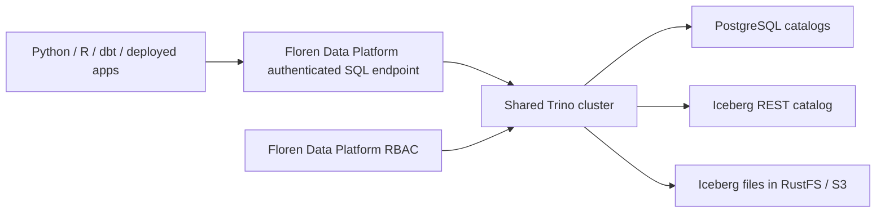

# Shared SQL execution

Implemented: one shared Trino 484 SQL path for PostgreSQL and Iceberg. Native PostgreSQL
credential issuance remains available only with `FDP_QUERY_EXECUTOR=native` for
older deployments. The default and Compose/Helm deployments use `trino`.

PostgreSQL is a data-platform backend chosen for deployment portability and fast
small queries where appropriate. Iceberg supports lake-scale storage and analytics.
Preserving native transactional application semantics is not a design objective.
Portability means the platform can target either backend through the common SQL
interface; it does not imply automatic data migration or identical SQL capabilities.

## Topology

Use one Trino cluster initially; a single-node coordinator/worker is sufficient for
local development. Separate Python/R application compute pools remain responsible for
running code. They submit governed SQL to the shared engine. A single SQL entry point
does not imply that PostgreSQL stops executing pushed-down work.

Each PostgreSQL database becomes a Trino catalog; Iceberg gets a separate catalog.
Object names follow `catalog.schema.table`, for example `finance.reporting.revenue`
and `lake.analytics.events`. Queries can join across catalogs without first copying
all PostgreSQL tables into Iceberg. The Iceberg catalog and object store remain
required infrastructure; Trino supplies SQL planning and execution.

## Authorization and credentials

Keep the existing SCIM directory, app groups, fixed roles, folders, and service
identities. Map catalog/schema objects onto existing data-source/schema resources.
Schema assignments continue to cover current and future objects.

Trino must enforce actions on every referenced schema, including cross-catalog
queries and source/target checks for writes and moves. Discovery must hide objects
outside the effective grants. Use Trino's system access-control integration to
consult Floren Data Platform policy. The OPA plugin calls signed-context, OPA-compatible endpoints
in the control plane directly; a separate OPA process is not needed. Floren Data Platform
remains the authority for permission assignments rather than introducing a second
independent SQL role-management system.

The SQL endpoint authenticates the actual user or workload. Never trust a client-
supplied Trino username, run ID, group list, or execution-mode header as authority.
Forward a verified identity and protected execution context to Trino, with no
public route that permits callers to bypass that authentication boundary.

Caller-mode shared apps resolve the signed viewer on each SQL request and use live
permissions. Fixed-mode workloads use their registered service or authorized
service account. Admitted jobs retain their recorded permission snapshot until
completion; new jobs, retries, and scheduled invocations require fresh admission.
Policy callbacks must preserve this distinction rather than accidentally applying
live revocation to every subsequent statement of an already-admitted job.

Backend PostgreSQL credentials, Iceberg catalog credentials, and lake object-store
keys stay on engine/catalog infrastructure. Workloads must have neither those
credentials nor direct network access that bypasses Trino. Provision a PostgreSQL
connector account with authority only over managed schemas, without superuser or
role-administration privileges. Existing native PostgreSQL end-user credential
leases are a migration concern, not the new connection API.

Native SQL passthrough and catalog/table procedures are denied. Iceberg registration,
custom locations, authorization changes, unreviewed table properties and definer views
are denied. Views must explicitly specify `SECURITY INVOKER`, including statements
wrapped in PREPARE or EXECUTE IMMEDIATE. PostgreSQL native views and foreign tables are
inventoried using pooled infrastructure metadata connections at each query admission
and excluded because their hidden dependencies cannot be checked by Trino. Use
invoker views in the Iceberg catalog or materialized data for those use cases.

Catalog/schema/table discovery is filtered by Trino's policy callbacks. The two
`system.metadata` tables required by dbt additionally get mandatory schema row filters;
runtime/system configuration and query-inspection tables are unavailable. Unknown
operations fail closed. Infrastructure administrators must not alter native relation
kinds or catalog mappings while requests run.

Plain-file access remains separate from SQL: retain the scoped S3/delegated file
API, using storage paths distinct from governed Iceberg metadata and data files.
SQL execution uses Trino; the platform does not bundle an embedded SQL engine.

## Client and SQL contract

Python, R, dbt, and delegated app queries use the same SQL endpoint and Trino
dialect. Use dbt-trino for both PostgreSQL-backed and Iceberg-backed targets.
Retain the existing source selection UX while resolving each source to its
configured Trino catalog. Include effective identity, initiating identity, run or
workload ID, and Trino query ID in audit records.

Role permissions express authorization, not guaranteed connector capabilities.
Trino's PostgreSQL connector supports reads, writes, and schema/table operations,
but restricts UPDATE assignments and DELETE predicates and does not expose all
native PostgreSQL features. Do not promise PostgreSQL wire compatibility, complete
transactional application behavior, or identical cross-catalog write semantics.
The gateway uses autocommit and rejects explicit multi-statement transactions.
Unsupported operations should return a clear capability error, never silently
fall back to shared native credentials or unrestricted SQL passthrough.

## Small-query performance

Retain one Trino execution path initially. For suitable PostgreSQL queries, Trino
can push supported filters, projections, aggregations, limits, and joins into the
database. PostgreSQL then plans that work and may use indexes, so an indexed lookup
need not become a full scan or move a large table through Trino. Verify actual
pushdown for representative queries rather than assuming every expression qualifies.

Pushdown does not remove the SQL gateway and Trino planning, scheduling, and result
delivery overhead. Fast small requests are an explicit performance goal, and native
PostgreSQL latency must not be promised through this architecture without measurement.
Benchmark end-to-end p50/p95 latency and throughput for indexed point lookups,
selective filters, small aggregations, and repeated app requests under representative
concurrency. Compare the shared path against direct PostgreSQL as a measurement
baseline, and inspect plans for unintended remote scans and transfers.

Start with a warm engine, backend connection reuse, appropriate PostgreSQL indexes,
and validated pushdown. Consider a separately authorized native execution path only
if measurements show the shared engine misses the application's latency needs; that
would be a future architecture decision, not an automatic credential fallback.

## Delivery sequence

1. Pin a Trino release and add a local cluster with PostgreSQL and Iceberg REST/S3
   catalogs. Keep catalog/storage endpoints restricted to infrastructure.
2. Add authenticated SQL submission, result pagination/cancellation, and server-side
   schema action checks using the existing RBAC evaluator and execution contexts.
3. Route Python/R, delegated app queries, and dbt-trino through that path. Close
   native credential and network bypasses for the managed sources.
4. Validate all four roles on both catalogs, cross-catalog joins/writes, hidden
   metadata, future tables, DDL denial for Contributor, protected identities,
   passthrough denial, live viewer revocation, and retained job permissions.
5. Measure PostgreSQL small-query latency through the full shared path, including
   concurrent app traffic, and validate pushdown against the direct-query baseline.
6. Migrate the demo and document connector SQL limitations. Defer further native
   permission adapters while this shared SQL path is the priority.

The existing RBAC model can be reused. This changes the data execution and
enforcement boundary; it does not require another identity/group design.

## Deployment and migration

Compose includes one private Trino node with `finance` and `lake` catalogs, an Iceberg
REST catalog and RustFS. Workloads cannot connect to the PostgreSQL warehouse,
Iceberg REST endpoint or coordinator network. RustFS also serves separately scoped
plain-file credentials; the reserved lake bucket cannot be registered or accessed
through the plain-file API. `FDP_SQL_LAKE_BUCKETS` is the comma-separated
reserved bucket list and defaults to `lake`.

1. Rebuild the control plane and every Python/R/dbt/workspace runtime in use. Old
   native SDK clients cannot use the new connection metadata. Existing deployed
   workloads must be redeployed with the rebuilt runtime images.
2. Configure each engine catalog on infrastructure, using credentials restricted to
   managed resources. Set the matching `catalog` in its Floren Data Platform source config.
   Register a physical database/schema only once; duplicate catalog mappings are rejected.
3. PostgreSQL requires an engine-only `secret` (username/password, matching the catalog
   connection) and a separate `provisioner_secret`. Provisioning reconciles ownership
   and PUBLIC privileges and gives the non-superuser/non-CREATEROLE engine login
   managed schema DDL authority. Neither credential is given to workloads. Iceberg
   registration reserves the namespace; an authorized Admin/Owner creates it in SQL.
4. Match `FDP_TRINO_SIGNING_KEY` with the decoded contents of Trino's
   `gateway.hmac` file. This is a separate key from the control plane's session key.
   Only the gateway mints coordinator JWTs. Public clients use their existing
   workload/service tokens. Trino's policy context is separately signed and bound
   to a durable query admission, so a forged X-Trino-User or extra credential grants
   no access. Do not log policy request bodies or continuation tokens.
5. Retire old native end-user passwords and leases, and drain pre-migration workloads.
   Startup removes managed SQL-source Kubernetes egress policies; rebuilt pods also
   omit native SQL egress labels. This cannot recall externally copied credentials.
   Source connection changes are refused while dependent jobs/SQL requests run.

`make storage-example` registers the example storage's two catalogs as storage integrations
(see [storage integrations](storage-integrations.md)); `EXAMPLE_STORAGE=1 POKEMON_STORAGE=0 make seed` adds namespaces, group
bindings and example roles.
It creates Iceberg namespaces through the shared SQL API. The reference REST catalog
is development infrastructure, protected behind the engine; production may substitute
a durable REST-compatible catalog without changing the SDK API.

Helm includes a single-node Trino Deployment, Service, configuration and ingress
NetworkPolicy. Supply `trino.existingSecret` with `gateway.hmac` (base64 text of the
gateway HMAC key) and `internal-secret`, and `trino.catalogSecret` with one
`<name>.properties` entry per catalog. Put `FDP_TRINO_SIGNING_KEY` in the
control-plane Secret. Catalog secrets and data are mounted outside workload pods.
Use a network-policy-capable CNI and restrict external backend firewalls/ingress to
infrastructure; arbitrary external network policy is not provisioned by this chart.
Internal HTTP is enabled explicitly on the private coordinator for the local/single-node
setup; configure backend TLS or a service mesh when the infrastructure network requires it.

## Clients and validation

Python `connect()` returns a Trino SQLAlchemy engine; R `connect()` returns a DBI
connection with paginated fetching and cancellation. Both renew active-job workload
tokens. `query(source, sql, parameters=[...])` uses positional `?` parameters and
supports either viewer-bound or ordinary workload calls. Interactive query helpers
cap results at 10,000 rows and time out after 30 seconds; standard connections stream
pages up to the configured engine/query lifetime. dbt profiles use dbt-trino with
existing API authentication, certificate validation enabled, and the selected catalog.
Profiles contain workload API tokens, never native database or object-store keys.
The SQL gateway also accepts a correctly signed expired job token while that exact
job remains active, matching the existing workload-renewal rule. This lets dbt's
static profile complete long jobs without extending editor or workload tokens.

The standard protocol is `/v1/statement` plus signed `/v1/sql/pages/...` continuations;
status is available at the response's `infoUri`. Deleting a continuation cancels the
request. Pages are bound to the submitting principal, workload and viewer. Audit stores
the effective/initiating identities and engine query ID, without SQL text or values.
Completed admission records expire for access after one hour by default; the audit
log remains separate. The reaper removes admission records seven days after expiry.
The local engine also caps query runtime at one hour. R preserves bigint/decimal
columns as strings and complex values as list columns; convert explicitly when an
analysis intentionally accepts numeric rounding.

`tests/test_shared_sql.py` covers the gateway and policy matrix. Live tests use
`tests/sql-integration/compose.yml` and `tests/test_trino_integration.py`, including
real PostgreSQL, Iceberg/RustFS, Python, optional R/dbt clients and retained jobs.
`tests/benchmark_sql.py` measures indexed lookups, selective filters and small
aggregations at concurrency 1/4, saves p50/p95/throughput and EXPLAIN plans, and
compares the shared path with a direct PostgreSQL measurement baseline.

Run `make test-sql` after installing the SDK SQL extra in the control-plane venv.
This starts/stops a separate disposable Compose project and temporary callback server
on port 18347; it never joins the development stack. For optional client verification,
set `FDP_TEST_DBT` to a dbt-trino executable and `FDP_TEST_R_LIBS` to an R
library containing the SDK dependencies. Set `FDP_TEST_SQL_BENCHMARK` to an
output path to include measurements. Docker Desktop supplies the callback hostname;
Linux needs `host.docker.internal` routed to the host running the tests.

Benchmark the shared query path on your own infrastructure. Trino preserves database
execution advantages but adds request, planning and policy overhead for small calls;
local development measurements should not be treated as a production SLA.

Custom roles, object-level grants, extra SQL connectors, a native low-latency bypass,
multi-node query pools and automatic catalog-secret reconciliation remain outside
this first single-engine release. The SQL access rules do not govern infrastructure
administrators acting directly on database/catalog/storage servers.

## References

- [Trino PostgreSQL connector](https://trino.io/docs/current/connector/postgresql.html)
- [Trino Iceberg connector](https://trino.io/docs/current/connector/iceberg.html)
- [Trino OPA access control](https://trino.io/docs/current/security/opa-access-control.html)
- [Trino query pushdown](https://trino.io/docs/current/optimizer/pushdown.html)
