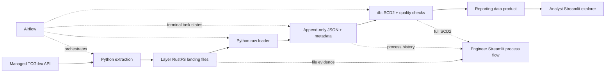

# Pokémon: governed API-to-product pipeline

Two English sets (`base1`, `base2`), separate **Test / Non-Prod** and **Prod / Prod** deployments.
`test` is the development branch; protected `main` is the production promotion branch.
The source API is [TCGdex](https://tcgdex.dev/rest/set).

The workload code (extraction, loader, dbt, Airflow and the two Streamlit apps) lives in its own Git
repository, registered with read-only credentials. Protect `main` and promote through a reviewed pull
request; the platform binds the production folder to `main` and gives each layer its own identities
either way.

Warehouses default to the installation's `xsmall`/`small`. Pass `warehouses` (`app`, `job`,
`orchestrator`) to use your own, for example a dedicated Airflow warehouse per layer.

`demo_data_policies = true` adds column masks and a row filter to the product table for
demonstrations; the identities that build the product are exempt (see the documentation's
Pokémon example).



## Data and retry contracts

`ingestion/extract.py` calls **API management**, never the public endpoint directly. It batches
responses into JSON arrays in its layer's **RustFS**, under a separate `pokemon-landing` bucket.
A small run writes one sets array and one cards array, plus a completion manifest. Each array
preserves the original response bytes and nested lists; only the raw-table loader separates
objects into records. Arrays split into bounded parts at 16 MiB as volume grows. The
Iceberg warehouse bucket remains reserved for table files. A complete extraction writes its
manifest last; conditional S3 writes refuse to replace an existing object with different bytes.
An extraction retry reuses a completed manifest without re-fetching the API.

`ingestion/load_raw.py` reads that manifest and validates the environment, batch, paths, SHA-256,
byte lengths, response counts and source-response byte ranges/checksums. The v2 manifest maps
each array element to its API endpoint and capture time. Legacy v1 manifests remain readable
without rewriting historical files. Each root JSON object becomes one raw row at this step. Every object inside a
nested JSON list also becomes a row, linked to its parent and exact JSON pointer; scalar lists
remain in their parent JSON. Root and nested payloads retain all fields. A list of root objects
becomes one root row per object, rather than a single JSON-array row.

The raw schema has four physical tables:

| Table | Contents |
|---|---|
| `pokemon_raw.records` | JSON plus stable `record_id`, `observation_id`, parent ID, entity type/ID, content hash, file ID/URI/SHA, JSON pointer, batch, load attempt and UTC timestamps |
| `pokemon_raw.files` | Source endpoint, file size/hash/path, extraction time and record count for each loaded file |
| `pokemon_raw.load_commits` | Completion markers and expected counts; only complete load attempts enter dbt |
| `pokemon_raw.process_events` | Append-only process history: load attempts, extraction evidence, Airflow stage outcomes/try counts/execution IDs and terminal pipeline results |

Payloads use `varchar` JSON for portability through Trino/Iceberg; the S3 file is the original
byte-level evidence; the manifest locates each original response within the array. `record_id` is stable for an upstream entity across all processing layers.
Nested objects use their own ID within their parent/path; objects without an upstream ID use
list position, so reordering such a list is recorded as changed positions. `observation_id` identifies
one entity observation in a batch; `record_version_id` identifies the first observation of an SCD2
version. `file_id` identifies an immutable landing object. Batch IDs derive from environment +
Airflow run ID; retries/clears share that ID, new DAG runs create new observations.

The loader only inserts. A failed attempt keeps its partial rows and failure event without a
completion marker. A retry uses a fresh load ID. A completed batch is a no-op on retry; if two
manual attempts finish concurrently, staging selects the first completed attempt deterministically.
Airflow runs only one DAG run at a time per environment. Do not run independent dbt builds
concurrently against the same schemas.

The raw schema's `append_only = true` is enforced by the governed Trino policy: no update,
delete, truncate, rename, destructive DDL or table-property changes, including for Admin/Owner.
Only structured `CREATE TABLE IF NOT EXISTS` receives a query-local initial-setup exception;
`CREATE OR REPLACE`, including prepared/EXECUTE IMMEDIATE forms, is refused. This protects
platform SQL access; cluster/storage administrators remain trusted recovery operators.
The bootstrap job uses its own privileged identity and never drops existing objects.

## dbt and products

`stg_records` admits complete, deduplicated observations. `record_history` builds full observed
SCD2 for roots **and nested records**: unchanged observations update `last_seen_at` without a
new version; A→B→A retains three versions. Intervals are half-open `[valid_from, valid_to)`,
with exactly one current version. No deletion is inferred from missing upstream data. Upstream
`updated` fields stay in raw payloads but are excluded from business-change hashes.

`dim_cards_history` / `dim_sets_history` add readable columns while retaining record/version IDs,
raw payloads and file provenance. All complete observations remain queryable in `stg_records`,
including unchanged observations and their original files.

`reporting.cards_current` and `reporting.set_summary` are physical analyst products. The card
product retains stable record/version IDs, but excludes raw JSON, storage paths and process
internals. Tests cover uniqueness, required fields, SCD2 intervals, file evidence and complete-load
counts. Airflow builds/tests `tag:engineering` before `tag:product`, so raw/history quality failures
block product builds. dbt publication is not a multi-table transaction; consumers should use the
catalog SLA/run status to distinguish a failed product build from a successful release.

Workspace builds always use private `dbt_<user>` schemas, including product models. They never
write the shared reporting schema. Use the published Test workloads for end-to-end acceptance.

## Access model

The module uses existing **Data engineers** and **Analysts** security groups, distinct from
workload folders. The platform's Global Admin recovery access remains in effect.

| Principal | Grants |
|---|---|
| Data engineers | Admin on project folder, landing/raw/history schemas and managed API; existing lake Admin grants cover reporting |
| Analysts | Reader on reporting; Executor on the explorer only; no monitoring app, raw/history/files/API or pipeline grants |
| Extract identity | Consumer on managed API; Contributor on its landing namespace; no database grant |
| Load identity | Reader on landing; Contributor on raw; no API grant or DDL |
| dbt identity | Reader on raw; Admin on history/reporting; no landing/API access |
| Explorer identity | Reader on reporting only |
| Monitor identity | Reader on raw/history only |
| Airflow identity | Executor on extract/load/dbt/process-event jobs; no data/API access |
| Process-event identity | Contributor on raw only |
| Bootstrap identity | Admin on raw/history/reporting for initial schema/table creation |

Every stage uses its own **built-in workload managed identity**, fixed to its layer.
No separate service accounts are needed. Direct permissions are declared through
`managed_identity_grants` on each Terraform workload (FDP provider 0.2.0 or later). RustFS root
credentials stay inside the platform; service identities receive short-lived **STS sessions**
scoped to their granted prefixes. Terraform does not need S3 keys. Source-specific network rules
allow those executions to reach only their own layer's RustFS. Test identities cannot use Prod
storage, APIs, workload identities or SQL even when a human belongs to groups in both layers.
Do not add Analysts to Data engineers: permissions are additive and inherited grants cannot be blocked.

The explorer is the **data-product dashboard**: searchable cards, set summaries and downloads.
The monitor is the **process-flow dashboard**: stage graph, process history, SCD2 by record ID and
file/JSON-pointer drill-down, including incomplete attempts. Fixed identities make its cache safe
within its engineer-only access boundary. It displays limited rows; engineers can query the full tables.

## Deploy with laptop OpenTofu

The reusable module is `terraform/modules/pokemon` (also mirrored in this repository's
`terraform/` directory). It requires FDP provider 0.2.0 or later. Keep the shared FDP
configuration and this application's configuration in separate Terraform roots and states.
The installation-local setup uses `data-platform/terraform` and
`data-platform/pokemon/terraform`; those files are deliberately outside the public source.

1. Deploy the platform version that supports managed RustFS files and append-only schemas.
2. Publish this code to a dedicated Git repository (`fdp.json` at root), with `test` and
   protected `main` branches. Promote through a reviewed merge; never copy Test data,
   identities or credentials into Prod.
3. Apply the shared platform root, then the Pokemon root. Allocate a `pokemon-landing`
   bucket in each layer's existing RustFS; no additional storage service is required.
   First-time private repository registration uses the ephemeral
   `TF_VAR_repository_credentials` map (`username`, `token`). It is stored server-side,
   never in Terraform state or workspaces.
4. Use ordinary `tofu init`, `tofu plan -out=pokemon.tfplan`, `tofu show pokemon.tfplan`
   and `tofu apply pokemon.tfplan` in the Pokemon root. Use its pinned provider/module
   versions and configure `TF_CLI_CONFIG_FILE` if using a local provider mirror.

5. Run `pokemon-bootstrap-test` once, then trigger `pokemon_test_daily` in the Test Airflow UI.
   Verify history, file traces, products and access before running `pokemon-bootstrap-prod` and
   `pokemon_prod_daily`. The bootstrap job is separate from the recurring DAG.

Catalog entries are tagged **Pokemon**, environment and **Data product / Process flow**.
SQL capture links loader → raw and apps → tables; the SDK records S3 file input/output lineage;
managed API calls connect the API → extractor; native dbt artifacts add the model graph;
Airflow adds the orchestration overlay. No manual per-file/table lineage lists are required.

## Verification

Use the control-plane venv (including its development dependencies) and the SDK:

```sh
services/control-plane/.venv/bin/python -m pip install -r examples/pokemon/tests/requirements.txt
PYTHONPATH=sdk/python services/control-plane/.venv/bin/python -m pytest -q examples/pokemon/tests
python3 examples/pokemon/validate.py  # copied files, temporary provider, backend disabled; no live state
```

The tests execute the SCD2 window SQL against an isolated SQLite fixture and parse every model/test
as Trino SQL; they do not substitute for a real Trino/dbt deployment run.
